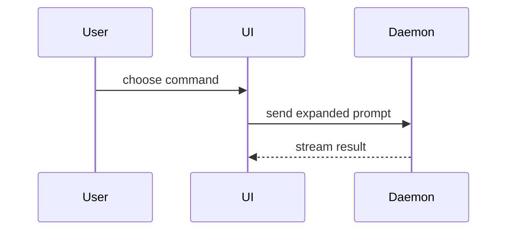

Use this template for writing the PR body:

```markdown
## Summary

<diagram, diff-sketch, or tree>

## Evidence

<optional: one line naming the screenshots' source, viewport, and baseline>

**<view>**

| Before       | After        |
| ------------ | ------------ |
| <screenshot> | <screenshot> |

- **Before:** <output/failing test run>
  **After:** <output/passing test run>

## Merge Danger

**Door:** <one-way or two-way>

<optional: description>

**Blast Radius:** <one-word description>

<optional: potential ramifications of merge>
```

## Sections

Skip all preambles and keep prose brief. Resolve the project's domain vocabulary through /domain-modeling and use its established language.

### Summary

Pick the smallest view that makes the key point clear.

- Show logic or an algorithm as pseudocode:

```text
on(save)
  if content is unchanged
    return cached result
  write new content
  return fresh result
```

- Show runtime control flow as a call tree:

```text
submitForm
  createSession
    persistPrompt
    launchAgent
  navigateToSession
```

- Show UI structure as a component tree, including state and module boundaries that matter:

```text
<SessionPage> (apps/example/src/routes/session.tsx)
  useSessionEvents()
  <SessionToolbar>
    <RunSkillButton> (packages/ui)
```

- Show file responsibility or a broad refactor as a shallow file tree:

```text
src/
├── commands/       # parses user actions
├── sessions/       # owns session state
└── transport/      # sends API requests
```

- Show component interaction, control flow, or data flow with Mermaid:



- Use `diff` when the point is what changes and the surrounding shape already exists. Match the diff shape to the topic.

For a component change:

```diff
 <SessionPage>
   useSessionEvents()
   <SessionToolbar>
+    <RunSkillButton />
   <SessionTimeline>
+    <SkillResultCard />
```

For a file-layout change:

```diff
 src/
 ├── commands/
+│   └── show-me.ts       # expands the slash command
 ├── sessions/
-└── transport.ts
+└── transport/
+    ├── client.ts
+    └── stream.ts
```

For a call-tree or call-stack change:

```diff
 submitForm
   createSession
     persistPrompt
+    expandSkillMention
     launchAgent
-  navigateToSession
+  navigateToSession
+    subscribeToEvents
```

For a state or control-flow change:

```diff
 on(save)
-  write content
+  if content is unchanged
+    return cached result
+  write new content
+  invalidate cache
```

- Show the whole block when most of it is new, when omitted context would hide ownership or order, or when the user needs a copyable target shape:

```ts
function expandSkill(command: string): string {
  const skillName = command.slice(1);
  return `use the ${skillName} skill`;
}
```

#### Guidance

Place each visual next to the short text it supports. Keep only the calls, files, props, states, and boundaries needed to answer the user's current question or the options to resolve the current discussion point.

You may use one of these, you may use several, it is unlikely you will use all of them. Use your judgement and don't overwhelm the user.

### Evidence

Concrete evidence that the change works. Show a before and after.

Screenshots are S-tier. When the change alters what a user sees on a view and capturing it is cheap, such as a running app, a dev server with mocks, or the project's verification skill, take before-and-after screenshots of that view. Take both with the same viewport, data, and scroll position, so the pair lines up.

Show each view as a bold label, at most one sentence on what changed, and a `Before | After` table whose one row holds the two screenshots. Open the screenshots with one line naming their source, viewport, and baseline, such as "Mocked checkout at 1280px. Before is `main`, after is this branch." Views that exist only after the change share one table: two screenshots to a row, or three for phone screenshots, with each screenshot's label in the cell above it.

When the forge CLI cannot attach images, as with `gh`, commit them to an images-only branch that never merges and embed each by commit SHA: `https://github.com/<owner>/<repo>/blob/<sha>/<file>.png?raw=true`. Make each upload's parent the branch's previous commit, so the push fast-forwards and the images in earlier PR body revisions keep resolving.

Execution-based evidence is A-tier. Test results, console output. Show the exact test that now fails and passes, using pseudocode.

### Merge Danger

Describe whether it's a one-way or two-way door. You can walk back through two-way doors, but not one-way doors. A PR that is cheap to roll back is lower risk. Changes that involve destructive actions or hard-to-reverse decisions are one-way doors.

The blast radius is the potential impact or scope of the changes introduced by this PR. Consider all possibilities. Examples are layout shift, breakages for consumers, mobile responsiveness, etc.

Complete when the description matches the final diff, shows observed evidence and limitations, and identifies merge risk. Use the invoking repository's contribution format when it overrides this default. This skill writes descriptions; publication follows the user's action grant.
