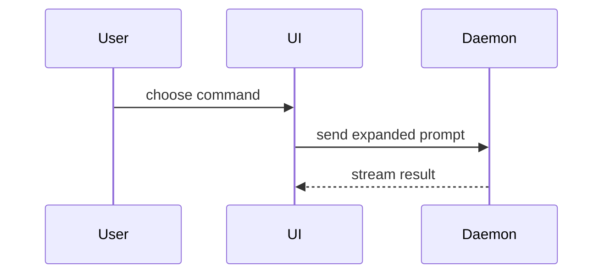

Use this template for writing the PR body:

```markdown
> <who-did-what line>

## Summary

<the problem in one paragraph>

<diagram, diff-sketch, or tree>

## Evidence

**Reviewed:** <the final review's verdict line, reviewer counts, and head SHA>

<or: **Not reviewed:** <reason>>

<optional: one line naming the screenshots' source, viewport, and baseline>

**<view>**

| Before       | After        |
| ------------ | ------------ |
| <screenshot> | <screenshot> |

<or, when there is no real before:>

| <state>      | <state>      |
| ------------ | ------------ |
| <screenshot> | <screenshot> |

<or, when the diff changes UI and has no screenshot:>

**Not verified on <surface>:** <reason>

- **Before:** <output/failing test run>
  **After:** <output/passing test run>

**Limits:** <what failed, couldn't run, or got worse, and what nobody has checked, or none>

## Merge Danger

**Door:** <one-way or two-way>

<optional: description>

**Blast Radius:** <one-word description>

<optional: potential ramifications of merge>

## ELI5

<two or three plain sentences someone outside the project would follow>
```

## Sections

Skip all preambles and keep prose brief. Most readers stop early, so the order puts what matters first. Resolve the project's domain vocabulary through /domain-modeling and use its established language.

### Who did what

When an AI agent wrote the change, open the body with one quoted line that tells the reviewer how much a human is behind it. Take the handle from `gh api user -q .login` when that account is the user's own; for a bot or shared account, ask the user for theirs.

| What the user did                                                         | First line                                                                                                 |
| ------------------------------------------------------------------------- | ---------------------------------------------------------------------------------------------------------- |
| Gave the task and approved the approach                                   | `> Written by an AI agent on behalf of @handle. @handle has not reviewed it yet.`                          |
| Wrote a spec (an issue, a doc, a plan) that you implemented               | `> Written by an AI agent on behalf of @handle, following their spec. @handle has not reviewed it yet.`    |
| Worked out the design with you: the architecture, the API, the trade-offs | `> Written by an AI agent on behalf of @handle, who shaped the solution. @handle has not reviewed it yet.` |
| Set up the scheduled task that ran this, without approving this change    | `> Written by an AI agent in a scheduled task @handle set up. @handle has not reviewed it yet.`            |

Picking one of your options is approving an approach, not shaping the solution; when in doubt, use the plainer line. Change the ending to `@handle has reviewed it.` only when the user says they have reviewed the PR. The line takes the place of a default footer such as "Generated with…". When the repository has a PR template, put the line above it.

### Summary

Open with the user's goal and the problem in one paragraph: what was wrong or missing, for whom, and how it showed up, with real numbers when there are any. Then pick the smallest view that makes the key point clear.

- Show logic or an algorithm as pseudocode:

```text
on(save)
  if content is unchanged
    return cached result
  write new content
  return fresh result
```

- Show runtime control flow as a call tree:

```text
submitForm
  createSession
    persistPrompt
    launchAgent
  navigateToSession
```

- Show UI structure as a component tree, including state and module boundaries that matter:

```text
<SessionPage> (apps/example/src/routes/session.tsx)
  useSessionEvents()
  <SessionToolbar>
    <RunSkillButton> (packages/ui)
```

- Show file responsibility or a broad refactor as a shallow file tree:

```text
src/
├── commands/       # parses user actions
├── sessions/       # owns session state
└── transport/      # sends API requests
```

- Show component interaction, control flow, or data flow with Mermaid:



- Use `diff` when the point is what changes and the surrounding shape already exists. Match the diff shape to the topic.

For a component change:

```diff
 <SessionPage>
   useSessionEvents()
   <SessionToolbar>
+    <RunSkillButton />
   <SessionTimeline>
+    <SkillResultCard />
```

For a file-layout change:

```diff
 src/
 ├── commands/
+│   └── show-me.ts       # expands the slash command
 ├── sessions/
-└── transport.ts
+└── transport/
+    ├── client.ts
+    └── stream.ts
```

For a call-tree or call-stack change:

```diff
 submitForm
   createSession
     persistPrompt
+    expandSkillMention
     launchAgent
-  navigateToSession
+  navigateToSession
+    subscribeToEvents
```

For a state or control-flow change:

```diff
 on(save)
-  write content
+  if content is unchanged
+    return cached result
+  write new content
+  invalidate cache
```

- Show the whole block when most of it is new, when omitted context would hide ownership or order, or when the user needs a copyable target shape:

```ts
function expandSkill(command: string): string {
  const skillName = command.slice(1);
  return `use the ${skillName} skill`;
}
```

#### Guidance

Place each visual next to the short text it supports. Keep only the calls, files, props, states, and boundaries needed to answer the user's current question or the options to resolve the current discussion point.

You may use one of these, you may use several, it is unlikely you will use all of them. Use your judgement and don't overwhelm the user.

### Evidence

Concrete evidence that the change works: what the author saw, so the reviewer doesn't have to rebuild it. Prose that describes a change is a claim, not evidence. Show a before and after when both exist; otherwise show the states the change adds.

Open it with the review status: `**Reviewed:**` with the final review's verdict line, reviewer counts, and head SHA, such as /review-loop's Clean line, or `**Not reviewed:**` with the reason. When the diff changes UI source and Evidence has no screenshot, add `**Not attached:**` when GitHub refused captures you took, or `**Not verified on <surface>:**`, naming the view or route and why it went unchecked. A refactor of UI source counts, even when nobody should see a difference. Before publishing, run `node ~/.agents/skills/pr/scripts/check-evidence.ts --body <file>` from the PR branch's checkout after committing, or the same script beside this skill where it is installed elsewhere, adding `--base <ref>` for a stacked PR; it names what Evidence still lacks.

Pick the evidence that fits the change, one item for each row it touches; a screenshot proves a layout and nothing about speed. Put output longer than about 20 lines in a `<details>` block under a one-line verdict:

| Change                     | Evidence                                                                                                                                                                        |
| -------------------------- | ------------------------------------------------------------------------------------------------------------------------------------------------------------------------------- |
| UI                         | Screenshots, by the rule below the honesty list. A short video for motion, hover, or a multi-step flow, and a phone width when layout is involved.                              |
| CLI, script, or build      | The real output of the same command on the base and on this branch, exit code included, copied as it ran. Give both sides the same fixtures or fakes, not a live account.       |
| Bug fix                    | The same input on both sides with each result, and the regression test, named in pseudocode, failing on the base. When it can't run there, such as code the base lacks, say so. |
| Performance                | What was measured and how (machine, runs, inputs), the numbers on both sides, and their spread across runs.                                                                     |
| AI or agent behaviour      | The same real prompts on both sides, how the answers were graded, time and cost per answer, and where the grading is unreliable.                                                |
| Agent instructions or docs | A run that follows the new text and shows the behaviour it changes, or a line saying none ran.                                                                                  |
| New API or feature         | The code a caller writes to use it.                                                                                                                                             |
| Anything else              | A small table, a diagram, or a page comparing both versions.                                                                                                                    |

Keep it honest:

- After is this branch. Before is the base branch, production, or the last deploy, captured from its own checkout or deploy; never revert or stash this branch to make one.
- Look at every capture before uploading it, and check it shows what changed. An upload can't be deleted, even after its reference leaves the body.
- Capture demo or sanitised data only: no real users, tokens, emails, or private messages.
- End Evidence with `**Limits:**`: what failed, couldn't run, or got worse, and any part of the test plan nobody has done, or `none`.
- For a security fix in a public repository, describe the impact at a high level and keep reproductions, payloads, and exploit steps out of the body until the fix is released, following the project's security policy.

When the change alters what a user sees on a view and capturing it is cheap, such as a running app, a dev server with mocks, or the project's verification skill, screenshot it. Take before-and-after screenshots when the base branch shows the same view in the same state, with the same viewport, data, and scroll position, so the pair lines up. When there is no real before, such as a new view or a state the base branch never reaches (a validation error, an empty result, a new step), screenshot each state the change adds instead. A placeholder or an unrelated base-branch screen is not a before. Lay out, name, publish, and check the captures by [the screenshots reference](references/screenshots.md).

### Merge Danger

Describe whether it's a one-way or two-way door. You can walk back through two-way doors, but not one-way doors. A PR that is cheap to roll back is lower risk. Changes that involve destructive actions or hard-to-reverse decisions are one-way doors.

The blast radius is the potential impact or scope of the changes introduced by this PR. Consider all possibilities. Examples are layout shift, breakages for consumers, mobile responsiveness, etc.

### ELI5

Close with two or three plain sentences someone outside the project would follow, such as a reader skimming the changelog. If you can't write them, the change probably isn't clear yet.

Complete when:

- the description matches the final diff;
- an agent-written change opens with the who-did-what line for what the user did;
- every claim has evidence next to it or says why there is none;
- nothing in it is invented: no number, result, or run you didn't see;
- it passes `check-evidence.ts`;
- it identifies merge risk; and
- its ELI5 uses no term a reader outside the project would need explained.

Use the invoking repository's contribution format when it overrides this default; the check then doesn't apply. This skill writes descriptions; publication follows the user's action grant.
